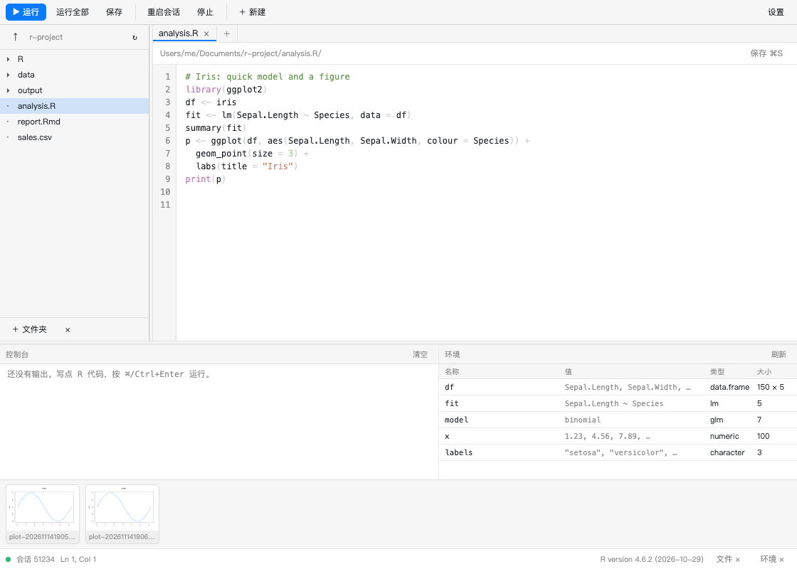
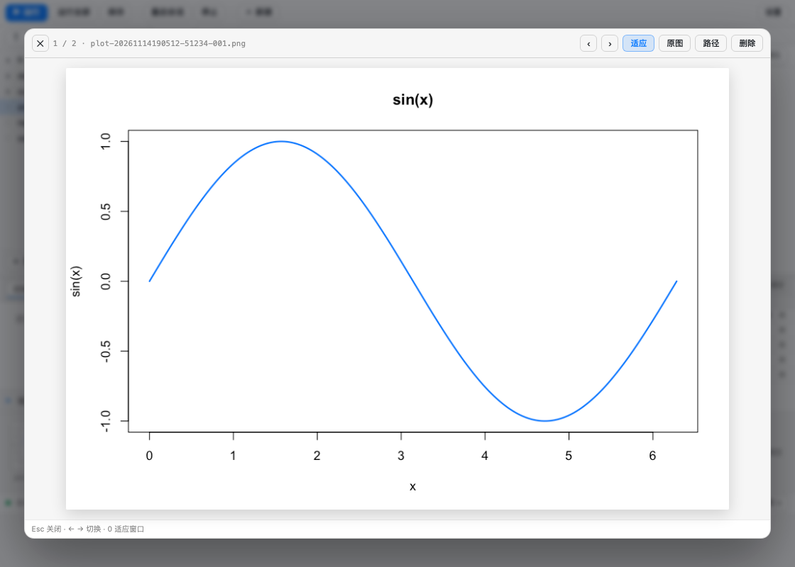
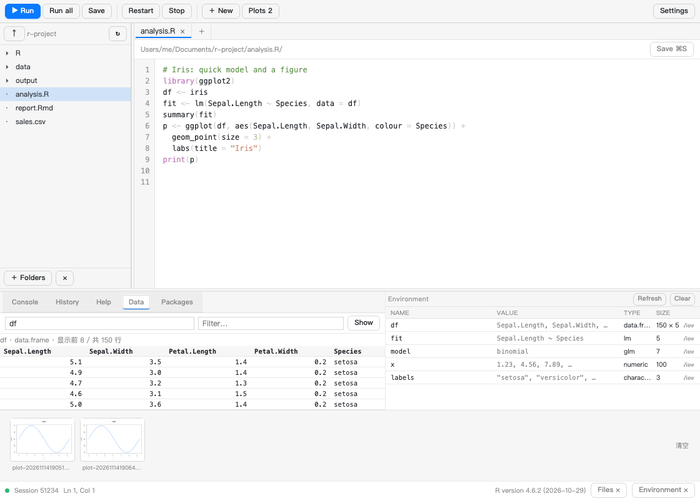
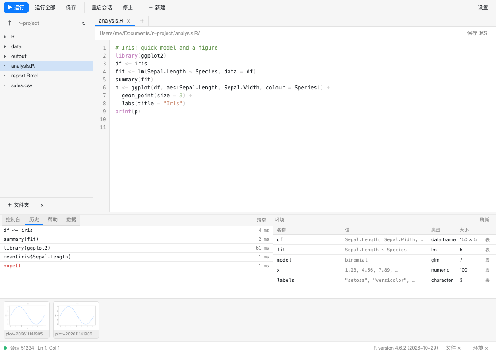

[](https://www.npmjs.com/package/dsh-r-runner)
[](LICENSE)
[](package.json)

# dsh-r-runner

Run R inside the DeepSeek Harness sidebar: a persistent R session, a file tree, a
syntax-highlighted editor, a console, an environment table, and plot thumbnails —
laid out like RStudio, with the keyboard habits of VS Code.

> Status: v0.1.5 on [npm](https://www.npmjs.com/package/dsh-r-runner), macOS + R 4.6 tested. See [docs/PLAN.md](docs/PLAN.md) for the
> design notes and roadmap.



Click any plot thumbnail to open it full-size — fit-to-window or 100 %, flip through
the set with ← →, copy the path, or open the PNG in a new tab:



The bottom pane has five tabs — console (with a real prompt), history, help, the data
viewer and the package manager:





## What you get

- **A session, not a script runner.** One long-lived `R --slave` process: variables,
  loaded packages and the graphics device survive between runs. A run costs 1–40 ms
  after the ~1 s boot.
- **RStudio-shaped layout.** File tree on the left, multi-tab editor in the middle,
  console and environment side by side at the bottom, plot strip above the status bar.
- **Editor habits from VS Code.** `⌘/Ctrl+Enter` runs the selection (or the buffer),
  `⌘/Ctrl+S` saves, Tab indents two spaces, the breadcrumb shows where you are.
- **Environment table.** Name / value / class / size, double-click a row to assign a
  new value with any R expression (`1:10`, `c("a","b")`, …); the **表** button opens
  the object in the data viewer.
- **Console prompt.** Type R straight into the panel: Enter runs, `Shift+Enter` adds a
  line, `↑`/`↓` walk the commands you already sent. Output lands in the same log as
  editor runs.
- **History.** Every run (editor, console, `r_run`) is kept in
  `~/.dsh/r-runner-history.json`; the 历史 tab lists them, click a row to put the code
  back in the prompt.
- **Help.** The 帮助 tab is `?topic`: it renders the real R help page
  (`utils:::.getHelpFile` + `tools::Rd2txt`) for anything installed locally.
- **Data viewer.** The 数据 tab previews a `data.frame` / `matrix` / vector — first 100
  rows, numeric columns right-aligned, `<NA>` marked.
- **Plots open in a floating window.** Every `plot()` is written to
  `.dsh-r-runner/plots/plot-<ts>-<pid>-NNN.png`. Clicking a thumbnail opens it in a
  centred window (portalled to `document.body`, so the sidebar cannot clip it):
  `‹ ›` browse, `适应 ⇄ 100%`, **原图** opens the PNG in a tab, **路径** copies the
  file path, **删除** removes that one plot, and the strip has a **清空** button.
  The files are plain PNGs an agent can read.
- **`.Rmd` runs one chunk.** With the caret inside an `{r}` fenced chunk, `⌘/Ctrl+Enter`
  runs just that chunk (the prompt says `chunk 2/3 · L12-18`); outside any chunk it
  falls back to the first one.
- **Completion, diagnostics, go-to-definition.** `Ctrl+Space` (or just typing `.`,
  `$`, `::`) opens a suggestion list built from your objects, the exports of every
  loaded package and base R; the gutter marks `parse()` errors and a few lint rules
  (`setwd(`, `attach(`, `=` for assignment), and `F12` / `⌘`-click jumps to a
  function's source — `source()`d files keep their `file:line`.
- **Package panel.** The 包 tab lists what is loaded (with versions) and what is
  installed (searchable, **载入** runs `library()`); `install.packages()` runs in a
  separate `Rscript --vanilla` process so the session never blocks, and the log stays
  on screen. If a run failed with *there is no package called 'x'*, the panel offers a
  one-click install.
- **Rmd preview.** **预览 Rmd** calls `rmarkdown::render()` into
  `<workdir>/.dsh-r-runner/rmd` and shows the HTML in an iframe; a failed render shows
  the tail of the log, and if `rmarkdown` is missing it offers to install it.
- **All plots grid.** The **图形 N** button opens every plot as a grid, from which you
  can zoom one or delete it.
- **Sortable data viewer.** The 数据 tab fetches up to 2000 rows: click a column header
  to sort (click again to reverse), type in 筛选 to filter across all cells.
- **Plot window you can resize.** Drag the bottom-right corner, use the zoom slider
  (10–400 %), **−** / **＋**, **适应 ⇄ 100%**, or **打开原图** (which falls back to
  copying the path when the browser blocks the new tab).
- **English UI.** 设置 → 信息 → 界面语言 switches the shell (toolbar, tabs, headers,
  status bar, plot window) between 中文 and English; the choice is remembered.
- **Folder picker, no blind typing.** The desktop shell has no `window.prompt()`, so
  **＋ 文件夹** (tree header and settings) opens an in-panel browser
  (`GET /r/api/browse`): `⤴` up, **主目录**, **工作区**, click a folder to walk in,
  double-click or **添加此文件夹** to add it as an extra root. The picker ignores the
  workdir guard on purpose — it only lists directory names.
- **Switchable working directory.** Settings → **选择目录** → **浏览…** picks a folder
  (this turns `autoDetect` off so the choice sticks), the **会话工作区** dropdown lists
  the DSH workspaces, and **跟随当前会话** makes the panel follow the session again.
- **RStudio projects.** The host reports the first `*.Rproj` in the working directory
  (settings → 信息 → 项目), and the default `scriptDir` follows the project root
  (`<project>/R`) instead of the bare working directory.
- **Shiny / Quarto preview.** With `app.R` / `ui.R` / `server.R` open the toolbar shows
  **运行 Shiny** (`shiny::runApp()` on a free loopback port, embedded in an iframe,
  **停止** kills it); with a `.qmd` open it shows **预览 Quarto**
  (`quarto render --output-dir .dsh-r-runner/quarto`, then the HTML is embedded). Both
  degrade to a readable message plus an install button when `shiny` or the `quarto` CLI
  is missing.
- **Agent tool.** `r_run({ code })` / `r_run({ file })` lets the model run R directly
  and get back the console output plus plot paths.

## Install

Requires [R](https://cran.r-project.org) on the machine (`R` on `PATH`, or point the
plugin at it in settings). No R packages are required.

### From the market

Search for **R Runner** in the plugin market, install, reload the page (⌘/Ctrl+R),
then open the right sidebar → add control → **R Runner**.

### From a checkout

```bash
cd plugins/dsh-r-runner
sh bin/install-local.sh          # copies the payload into the desktop profile
# reload the page, then open the R panel

# verify the host half is live (routes registered, R spawns, plots work)
node bin/check.mjs http://127.0.0.1:<gui-port>
```

`bin/install-local.sh` writes `~/.dsh/r-runner.json` on first run and adds the bundle
to the profile manifest; `bin/reload-host.sh` forces the host to re-compose.

## Use

| Action | Shortcut |
| --- | --- |
| Run selection / buffer | `⌘/Ctrl+Enter` |
| Run everything | toolbar **运行全部** |
| Save (overwrite the real file) | `⌘/Ctrl+S` |
| Open the panel | `⌘⇧R` (web: `⌥⇧R`) |
| Restart the R session | toolbar **重启会话** |
| Edit a variable | double-click its row in the environment table |
| View a data frame | the **表** button on its environment row, or the 数据 tab |
| Run a console command | type in the prompt, `Enter` |
| Previous / next command | `↑` / `↓` in the prompt |
| Look up help | 帮助 tab, type a topic, `Enter` |
| Completion | `Ctrl+Space`, or type after `.` / `$` / `::` |
| Jump to definition | `F12` or `⌘`-click on a name |
| Install a package | 包 tab → type a name → `install.packages()` |
| Add a folder | **＋ 文件夹** (tree) or **添加文件夹** (settings) → browse |
| Change the working directory | Settings → 选择目录 → **浏览…** / 会话工作区 |
| Run a Shiny app | open `app.R` → toolbar **运行 Shiny** |
| Preview a `.qmd` | open it → toolbar **预览 Quarto** |
| Render the `.Rmd` | **预览 Rmd** in the toolbar |
| Run the current `.Rmd` chunk | `⌘/Ctrl+Enter` inside an `{r}` chunk |
| Enlarge a plot | click its thumbnail (floating window) |
| Close / browse the plot window | `Esc` / `←` `→` / `0` (fit ⇄ 100 %) |
| Zoom a plot | the slider in the window bar, or `−` / `＋` |
| Resize the plot window | drag its bottom-right corner |
| All plots | **图形 N** in the toolbar |
| Delete a plot | hover a thumbnail → `×`, or **删除** in the window |
| Empty the environment | **清空** next to 刷新 in the 环境 header |

Notes:

- Files opened from the tree are edited **in place**; `＋新建` creates a draft that is
  written to `<scriptDir>/<name>.R` when you save it.
- Unsaved edits live in `localStorage`, so reloading the page does not lose them.
- Running a file switches the working directory to that file's folder
  (`runInFileDir`), which is what `read.csv("data.csv")` usually wants.
- `plot()` output is a PNG per plot. `par(mfrow = c(2, 2))` therefore yields four files.
- **清空** in the environment header runs `rm(list = ls(envir = globalenv()))`, so it
  empties your objects but keeps the session (and its loaded packages) alive.

## Configuration

`~/.dsh/r-runner.json` (edited from the panel's settings page, or by hand):

```json
{
  "rBinary": "/usr/local/bin/R",
  "rscriptBinary": "/usr/local/bin/Rscript",
  "sessionArgs": "",
  "workdir": "/path/to/your-project",
  "scriptDir": "/path/to/your-project/R",
  "extraRoots": [],
  "runInFileDir": true,
  "autoSave": true,
  "plotWidth": 960,
  "plotHeight": 640,
  "plotRes": 110,
  "timeoutMs": 600000,
  "maxOutputChars": 400000,
  "env": {}
}
```

- **R binary** — `R` is resolved from the setting, then `PATH`, then the common macOS
  framework locations.
- **Working directory** — `autoDetect` (default **on**) makes it follow the current DSH
  session workspace: switching projects in DSH moves the tree and the R cwd, and the panel
  re-checks every 15 s without a reload. Turn the checkbox off (or pick a folder) to pin it.
- **Script folder** — `scriptDirAuto` (default **on**) keeps drafts in `<workdir>/R`, or
  `<project>/R` when the folder holds an `*.Rproj`. Untick it to write to a fixed `scriptDir`
  (older installs pinned `scriptDir`; that stale value is now ignored while auto is on).
- **Extra roots** — additional folders shown in the tree (read/write allowed).
- **Plot size / resolution** — the PNG device parameters.
- **env** — extra environment variables for the R process (JSON object).

## Architecture

```
sidebar (lib/client.js: React via ModuleLoader, no build step)
      │  fetch /r/api/*
host half (lib/index.js: webServer + subprocess + workspaceRegistry)
      │  loopback TCP, newline-delimited JSON
R session (lib/driver.R: ping / run / vars / assign / rm / quit)
```

- `lib/driver.R` — the in-R server. Everything is wrapped in `local({ … })` so the
  driver's own objects never land in `globalenv`; `options(device = …)` redirects plots
  to PNG files; `capture.output(type = "output")` collects what `print`/`cat` printed.
- `lib/runner.js` — config, `RSession` (spawn, connect with retries, request queue),
  and the file helpers (tree, read/write, path policy).
- `lib/index.js` — routes, the `r_run` agent tool, workspace detection.
- `lib/client.js` — the panel. Hand-written `window.__ModuleLoader__.load({ factory })`
  bundle; no bundler, so editing it and reloading the page is the whole dev loop.

## Development

```bash
npm test                     # import / driver / host-unit / client-tokenize / client-smoke
node bin/preview-ui.mjs      # writes /tmp/rr-panel.html + /tmp/rr-settings.html
node bin/check.mjs <gui-url> # live check against a running DSH
```

`test/import.mjs` enforces the rule that keeps this plugin loadable across DSH
releases: **the host half may only import Node built-ins** (see Troubleshooting).

## Troubleshooting

**The panel is missing from the sidebar, and `r_run` is not in the tool list.**
The host half did not load. Check the route first:

```bash
curl -s -o /dev/null -w '%{http_code}\n' http://127.0.0.1:<gui-port>/r/api/state
```

`200` means loaded; `404` means it is not. On DSH ≥ 0.2.2 the usual cause is an import
that the profile can no longer resolve (`@deepseek-ai/dsh-tools` and friends). The
plugin then disappears silently — the plugin manager shows `enabled: true` with
`fiberPhase: null` (not `failed`, so there is no diagnostic). `test/import.mjs` exists
to catch exactly this; keep the host half on Node built-ins only.

**"R 不可用" in the settings page.** Point `rBinary` at the real binary
(`which R`, e.g. `/usr/local/bin/R`), then press **重启会话**.

**Run does nothing / hangs.** Open the toolbar **重启会话**, then run
`1 + 1`. If the session keeps dying, check `sessionArgs` (a bad flag kills `R` at
boot) and the console's error line.

**No plot thumbnail.** Plots come from the graphics device, so `plot()` must actually
be called; `ggplot2` objects need `print(p)`. Output lands in
`.dsh-r-runner/plots/` of the workdir — check the directory exists and is writable.

**First run feels slow.** The session boots `R` (~1 s) the first time; later runs reuse
it. **重启会话** pays that cost again.

**Warning: the R process can touch anything your user can.** It is not sandboxed;
`extraRoots` is a UI convenience, not a security boundary.

## License

MIT
